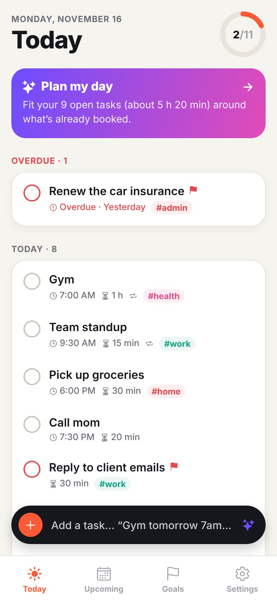
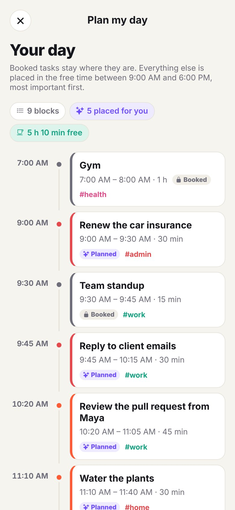
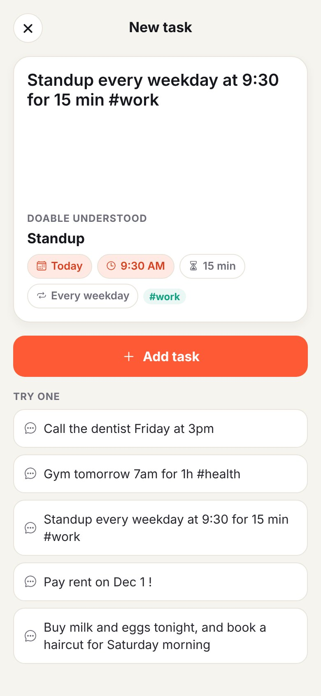
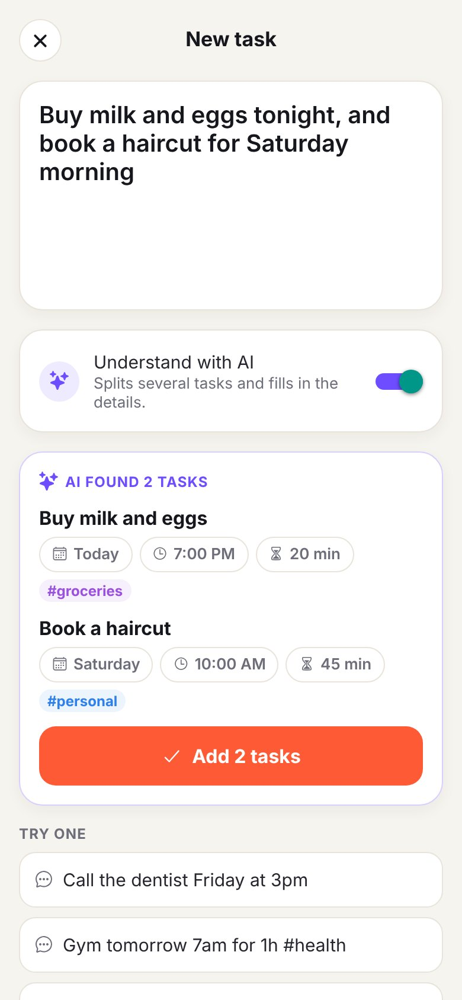
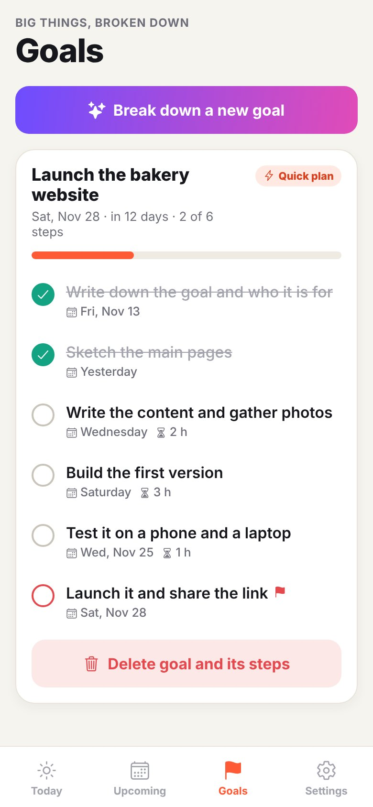
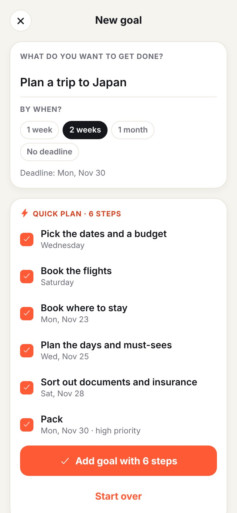
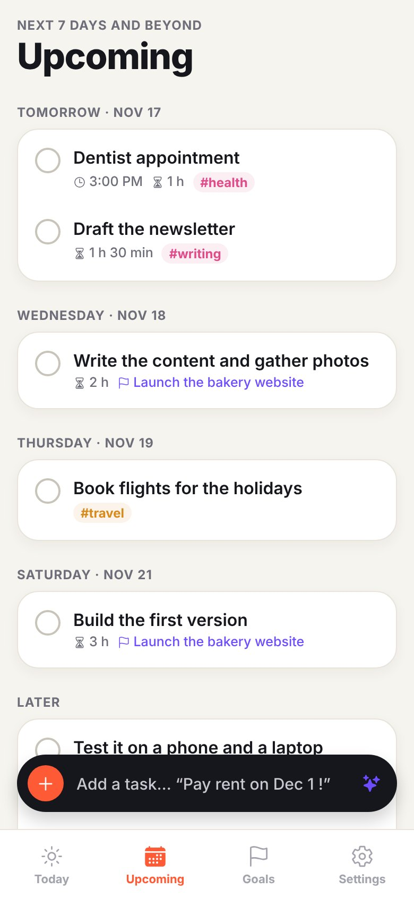
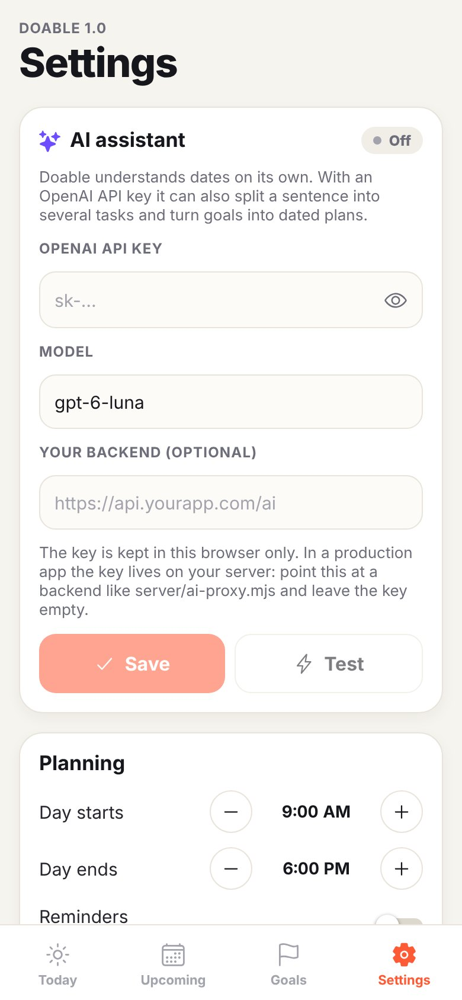

# Doable: AI task planner (React Native + OpenAI)

A **React Native (Expo) + TypeScript** planner for **Android, iPhone and the web**. Type tasks the way you would say them ("Gym tomorrow 7am for 1h #health") and Doable fills in the date, time, length, repeat, tags and priority as you type. **Plan my day** fits your open tasks around what is already booked, and the **OpenAI** integration splits a sentence into several tasks and turns a goal into dated steps, using **function calling** so the app always gets structured, validated data back.

<p>
  
  
  
  
</p>
<p>
  
  
  
  
</p>

## Try it

| Platform | How |
| --- | --- |
| **Web (any browser)** | [neomaverick1.github.io/doable](https://neomaverick1.github.io/doable/) |
| **Android** | Download `Doable.apk` from the [latest release](https://github.com/neomaverick1/doable/releases/latest) and open it on your phone. |
| **iPhone simulator (Mac)** | Download `Doable-iOS-Simulator.zip` from the same release, unzip it and drag `Doable.app` onto a booted simulator. |

Sample tasks and a goal load on first launch. Everything except the AI features works offline. To try the AI features, open **Settings** and paste an OpenAI API key (it stays on your device).

Every push to `main` type-checks, lints and tests the code, then rebuilds the Android app, the iOS simulator app and the web version automatically ([`.github/workflows/build.yml`](.github/workflows/build.yml)).

## Features

| Area | What it does |
| --- | --- |
| **Natural-language quick add** | Dates and times ("Friday at 3pm", "in 3 days", "Dec 1", "2-3pm"), durations ("for 1h 30m"), repeats ("every weekday", "every Monday and Thursday", "monthly"), `#tags`, `!` or "urgent" for priority, and lead-ins like "remind me to" are picked up live and shown as chips before you save. |
| **AI quick add** | With a key, one sentence such as "buy milk and eggs tonight, and book a haircut for Saturday morning" becomes separate tasks with times, lengths and tags. |
| **Plan my day** | A time-blocked plan for today: booked tasks stay put, open tasks fill the free gaps by priority (overdue first), nothing lands in the past, and what doesn't fit can move to tomorrow in one tap. **Apply** writes the times back to the tasks. |
| **Goals** | Turn "Launch my bakery website by Nov 30" into dated steps. The AI writes steps for the exact goal; without a key a built-in planner uses step templates spread evenly to the deadline. Progress bar and "next step" on every goal. |
| **Today / Upcoming** | Overdue, today and done sections, a progress ring, the next 7 days by day, later and someday. Completing a repeating task schedules the next one. |
| **Reminders** | A local notification when a timed task starts (iPhone and Android), kept in sync when tasks change, move or finish. |
| **Editing** | Title, notes, date, time, length, priority, tags and repeat on one screen. Haptics on complete. |

## AI integration

- **OpenAI Responses API with function calling** ([`src/lib/ai.ts`](src/lib/ai.ts)). The request forces the `create_tasks` tool with a **strict JSON schema**, so the model must answer with structured tasks instead of free text.
- **Every field is validated** before it reaches the app: real calendar dates, 24-hour times, sensible durations, known priorities, cleaned tags. Bad values are dropped, not trusted.
- **Clear failures**: wrong key, rate limit, timeout, network and server errors each get a plain message, and quick add offers to save the task without AI.
- **Keys**: stored in the iPhone Keychain / Android Keystore (the web build keeps it in the browser). For production the key belongs on a server: [`server/ai-proxy.mjs`](server/ai-proxy.mjs) is a small backend that adds the key, rate-limits callers and only lets the planner's tool call through. Point **Settings → Your backend** at it and leave the key empty.
- The model is configurable (default `gpt-6-luna`).

The README screenshot of AI quick add uses a sample model response; every other screenshot is the live app.

## Run it

Requires Node 20+.

```bash
npm install
npm start          # then press a (Android), i (iOS simulator) or w (web)
```

Optional AI backend:

```bash
OPENAI_API_KEY=sk-... npm run ai-proxy   # http://localhost:8787
```

## Checks

```bash
npm run typecheck  # TypeScript, strict mode
npm run lint       # ESLint (Expo config)
npm test           # 32 unit tests: sentence parsing, repeats, day planning, goal plans, AI request/response handling
```

## Project structure

```
src/
  app/                    Screens (Expo Router: each file is a route)
    (tabs)/               Today, Upcoming, Goals, Settings
    add.tsx               Quick add with live parsing and AI
    plan.tsx              Plan my day
    goal/new.tsx          Break a goal into steps
    task/[id].tsx         Edit a task
  components/             Task row, chips, buttons, progress ring, quick-add bar
  lib/
    parse.ts              Natural-language parser (dates via chrono-node) and repeat rules
    planner.ts            Day planner and offline goal planner
    ai.ts                 OpenAI Responses API client with function calling and validation
    notifications.ts      Local reminders
    secure.ts             API key storage (Keychain / Keystore)
    dates.ts, demo.ts     Date helpers and sample data
  state/                  Tasks and settings, saved on the device
server/ai-proxy.mjs       Optional backend that keeps the API key off the phone
__tests__/                Unit tests
```

## License

MIT © 2026 Randy Kundinger
